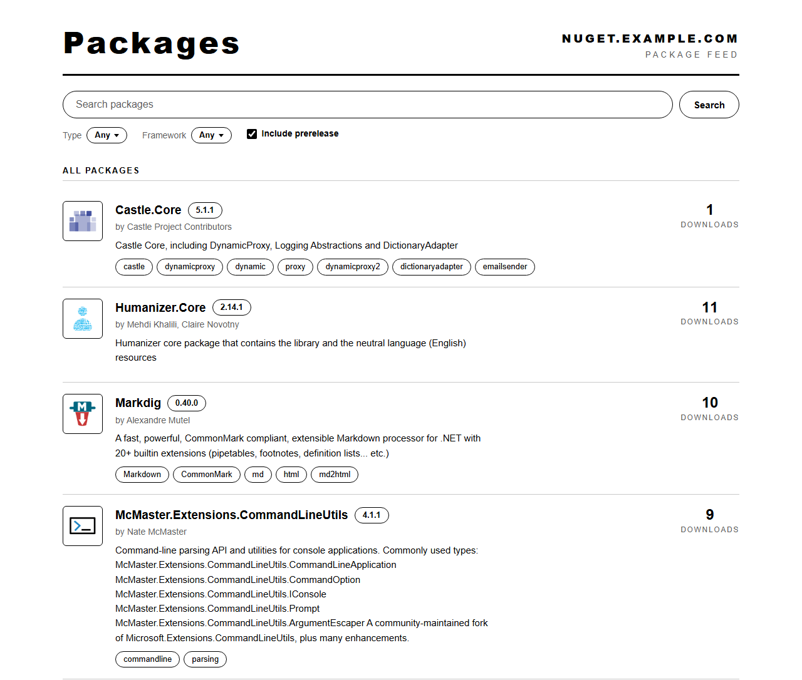
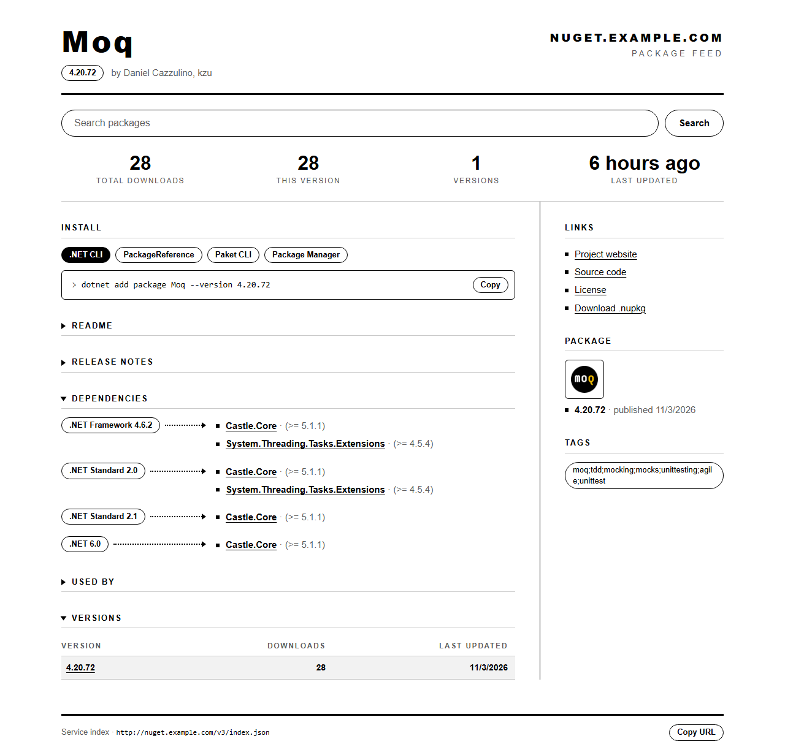
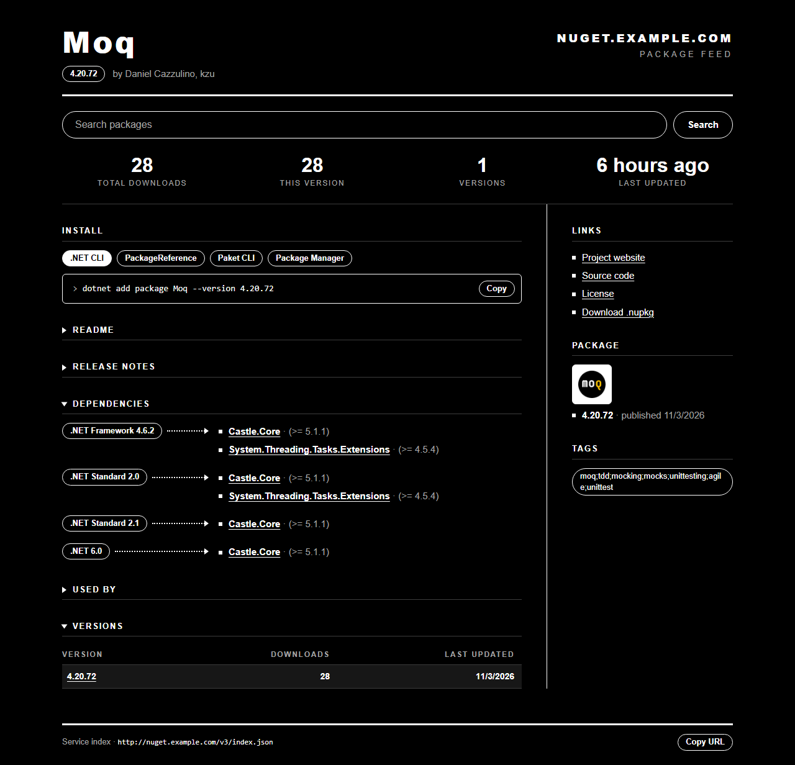

# BaGetter（orika 分支）

輕量的自架 [NuGet] 與[符號伺服器][symbol]。整個 feed，包括套件、符號檔、metadata 和搜尋，就是一個 SQLite 檔。

這是 [bagetter/BaGetter] v1.6.5 的自用分支（`orika/customizations`），目標是輕量簡單：只剩 SQLite，沒有雲端儲存，也沒有類型設定要選。



<p>
  
  
</p>

## 和上游的差異

- **.NET 10**，方案檔是 `BaGetter.slnx`。
- **只有一個檔案**：`Database:ConnectionString` 是唯一的儲存設定，`Database:Type`、`Storage:*`、`Search:Type` 都沒有了。MySQL、PostgreSQL、SQL Server，以及檔案系統、Azure、AWS、GCP、Aliyun、Tencent 儲存體都已移除。
- **單一檔案上限約 1 GB**（SQLite 的 BLOB 上限），所以 `MaxPackageSizeGiB` 預設是 1。
- **網頁介面**：單色重新設計；拿掉了上傳頁、統計頁和文件連結，標題和頁尾也不顯示 BaGetter 字樣與版本。
- **`import files` 指令**：把上游的檔案系統儲存搬進 SQLite。

細節和理由見 [AGENTS.md](AGENTS.md)。

## 開始使用

### .NET

需要 [.NET 10 SDK]。

```shell
dotnet run --project src/BaGetter
```

網址會印在主控台。資料庫預設是工作目錄下的 `bagetter.db`。

### Docker

這個分支沒有發佈 image，要自己建：

```shell
docker build -t bagetter .
docker run -p 5000:8080 -v ./bagetter-data:/data bagetter
```

然後打開 `http://localhost:5000/`。資料庫在 volume 裡的 `db/bagetter.db`。

沒有 Docker 也可以用 SDK 直接建 container image（`dotnet publish -t:PublishContainer`），做法見 AGENTS.md 的〈部署〉。

## 設定

設定寫在 `appsettings.json`，也可以用環境變數覆寫（`:` 換成 `__`，例如 `Database__ConnectionString`）。

| 設定 | 預設 | 說明 |
|---|---|---|
| `Database:ConnectionString` | `Data Source=bagetter.db` | SQLite 檔的位置，整個 feed 都在裡面 |
| `ApiKey` | 空白 | 推送和刪除時要帶的 key；空白表示不驗證 |
| `AllowPackageOverwrites` | `false` | 允許覆蓋同 id、同版本的套件 |
| `PackageDeletionBehavior` | `Unlist` | `Unlist` 只隱藏，`HardDelete` 直接刪除 |
| `MaxPackageSizeGiB` | `1` | 上傳大小上限 |
| `IsReadOnlyMode` | `false` | 拒絕推送、刪除和重新上架 |
| `PathBase` | 無 | 掛在子路徑下時使用，例如 `/nuget` |
| `Mirror:Enabled` | `false` | 本地沒有的套件向上游（預設 nuget.org）抓取並存下來 |
| `Authentication:Credentials` | 無 | Basic 驗證帳密；設定後連讀取 feed 都要帳密 |
| `Authentication:ApiKeys` | 無 | 多組 API key，和 `ApiKey` 並用 |
| `Retention:MaxMajorVersions` 等 | 無 | 每個套件保留的版本數 |
| `HealthCheck:Path` | `/health` | 健康檢查端點 |

其他選項（例如 mirror 的驗證方式）請看上游文件 <https://www.bagetter.com/docs>。上游文件裡關於資料庫類型、儲存體、搜尋類型、上傳頁和統計頁的內容，在這個分支都不適用。

## 使用 feed

```shell
dotnet nuget add source https://<host>/v3/index.json -n bagetter
```

之後 `dotnet restore` 就會到這裡找套件。套件頁上有各種用戶端的安裝指令，頁尾的 service index 網址可以直接複製。

## 上傳套件

網頁上沒有上傳頁，請用 NuGet 用戶端推送。service index 是 `https://<host>/v3/index.json`；如果有設 `PathBase`，要接在 host 後面。有設定 API key（`ApiKey` 或 `Authentication:ApiKeys`）時，要帶相符的 key；沒有設定時帶什麼都可以。

.NET CLI（同一個目錄下如果有對應的 `.snupkg`，會一起推送符號套件）：

```shell
dotnet nuget push -s https://<host>/v3/index.json -k <API-KEY> MyPackage.1.0.0.nupkg
```

NuGet CLI：

```shell
nuget push -Source https://<host>/v3/index.json -ApiKey <API-KEY> MyPackage.1.0.0.nupkg
```

Paket：

```shell
paket push --url https://<host> --api-key <API-KEY> MyPackage.1.0.0.nupkg
```

有設定 `Authentication:Credentials` 時，service index 也要帳密，所以要先帶帳密註冊來源，再用來源名稱推送（Linux/macOS 要加 `--store-password-in-clear-text`）：

```shell
dotnet nuget add source https://<host>/v3/index.json -n bagetter -u <USER> -p <PASSWORD>
dotnet nuget push -s bagetter -k <API-KEY> MyPackage.1.0.0.nupkg
```

新版 NuGet 用戶端拒絕推送到 `http://` 來源。要用 `--allow-insecure-connections` 註冊來源（需要帳密時再加 `-u`/`-p`），再用來源名稱推送：

```shell
dotnet nuget add source http://<host>/v3/index.json -n bagetter --allow-insecure-connections
dotnet nuget push -s bagetter -k <API-KEY> MyPackage.1.0.0.nupkg
```

回應碼：`201` 表示成功；`409` 表示同 id、同版本已經存在（除非開了 `AllowPackageOverwrites`）；`401` 表示 API key 錯誤或處於唯讀模式；`400` 表示不是有效的套件。

## 從上游 BaGetter 搬過來

上游預設把檔案放在 `Storage:Path` 底下的 `packages/`、`symbols/` 資料夾。前提是舊的資料庫本來就是 SQLite。把連線字串指向舊資料庫，再對那個資料夾執行一次：

```shell
Database__ConnectionString="Data Source=/data/db/bagetter.db" dotnet BaGetter.dll import files /data
```

指令會先套用 migration，再把資料夾裡的檔案用相同的路徑存進資料庫，重跑也沒關係。同名但內容不同的檔案會算成衝突，此時 exit code 是 1。舊資料夾不會被刪除，確認新版沒問題之後再自己清掉。

## 備份

最簡單的做法是先停止服務，再把 `bagetter.db` 複製走；如果旁邊還有 `bagetter.db-wal`、`bagetter.db-shm`，也要一起複製。不想停機的話，用 `sqlite3 bagetter.db ".backup 'backup.db'"`。

## 建置與測試

```shell
dotnet build BaGetter.slnx
dotnet test BaGetter.slnx
```

## 授權

[MIT](LICENSE)。原始專案是 [BaGet]，之後由 [bagetter/BaGetter] 社群接手維護；這個分支的修改一樣採用 MIT 授權。

[NuGet]: https://learn.microsoft.com/nuget/what-is-nuget
[symbol]: https://learn.microsoft.com/windows/win32/debug/symbol-servers-and-symbol-stores
[.NET 10 SDK]: https://dotnet.microsoft.com/download/dotnet/10.0
[bagetter/BaGetter]: https://github.com/bagetter/BaGetter
[BaGet]: https://github.com/loic-sharma/BaGet
