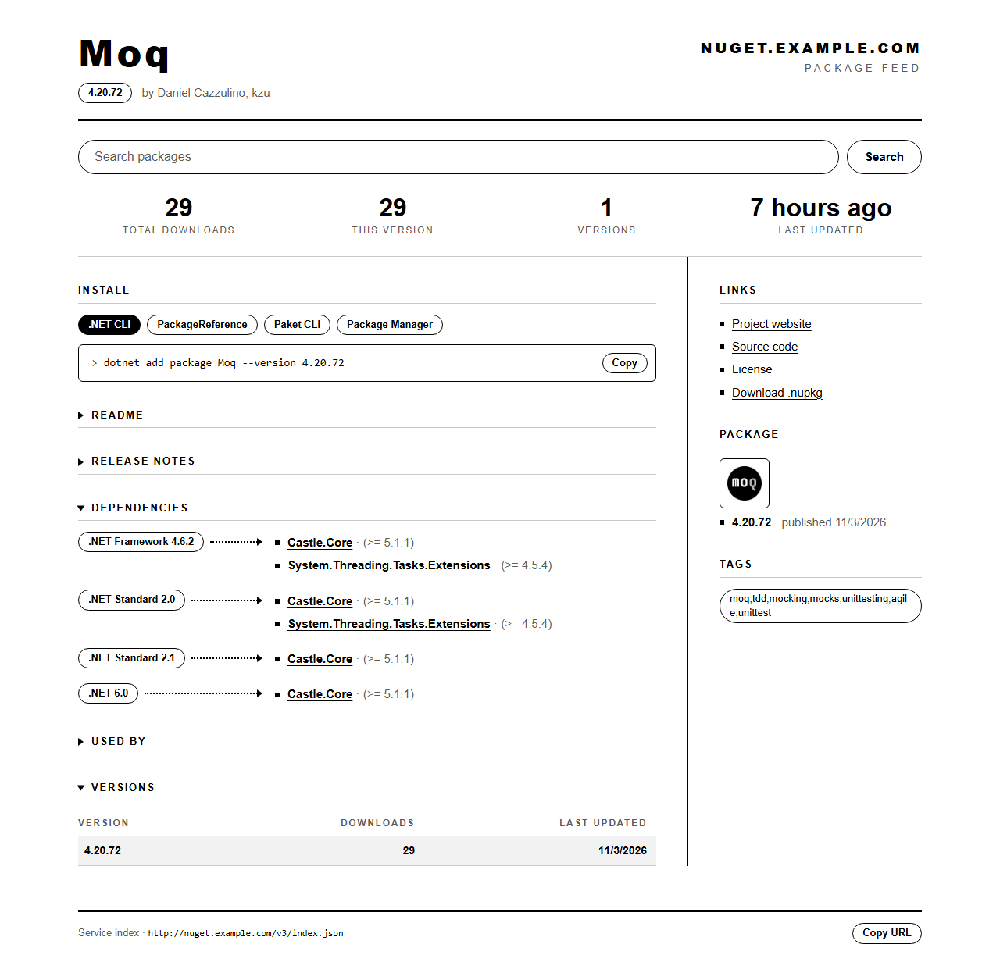
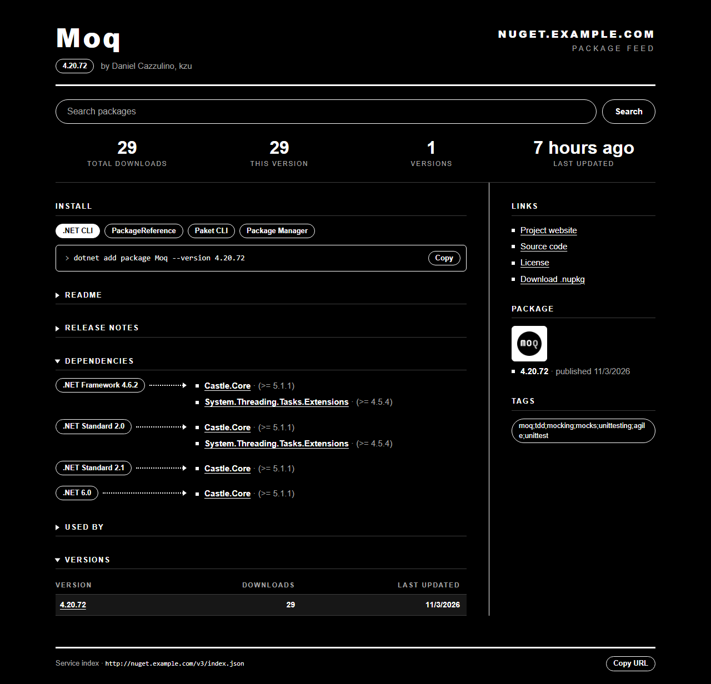

# Buffet

輕量的自架 [NuGet] 與[符號伺服器][symbol]。整個 feed，包括套件、符號檔、metadata 和搜尋，就是一個 SQLite 檔。

Buffet 從 [bagetter/BaGetter] v1.6.5 分出來，目標是輕量簡單：只剩 SQLite，沒有雲端儲存，也沒有類型設定要選。

  
  

## 文件

- [開始使用](docs/getting-started.md)：用 .NET 或 Docker 執行、備份、建置與測試
- [設定](docs/configuration.md)：設定項目與預設值
- [使用 feed 與上傳套件](docs/usage.md)：加入來源，以及用各種用戶端推送套件
- [從 BaGetter 搬過來](docs/from-bagetter.md)：和上游的差異，以及 `import files` 指令

## 授權

[MIT](LICENSE)。原始專案是 Loic Sharma 的 [BaGet]，之後由 [bagetter/BaGetter] 社群接手維護；Buffet 的修改一樣採用 MIT 授權，`LICENSE` 保留了兩者的版權聲明。

[NuGet]: https://learn.microsoft.com/nuget/what-is-nuget
[symbol]: https://learn.microsoft.com/windows/win32/debug/symbol-servers-and-symbol-stores
[bagetter/BaGetter]: https://github.com/bagetter/BaGetter
[BaGet]: https://github.com/loic-sharma/BaGet
